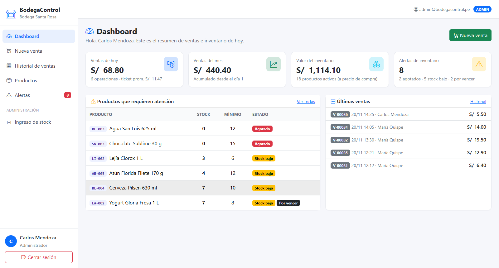
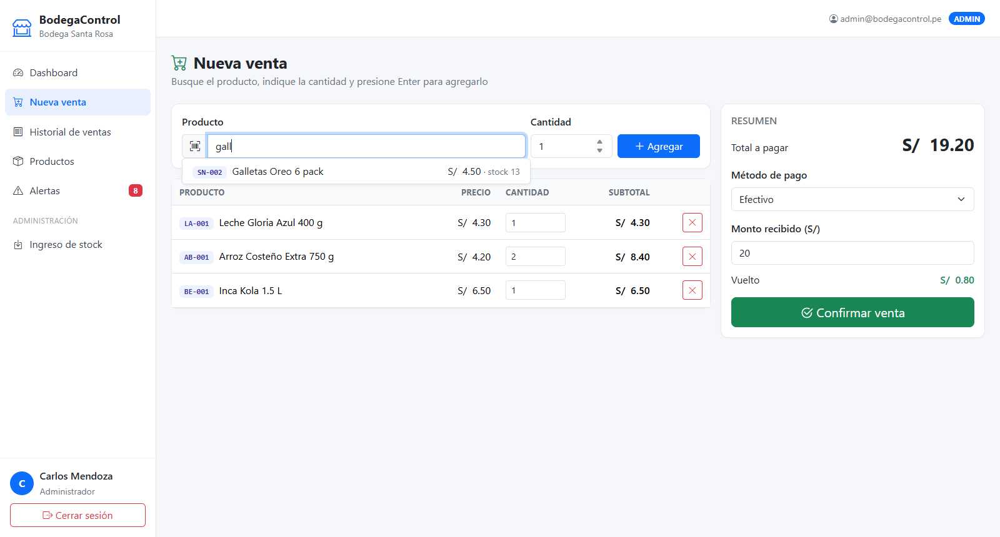
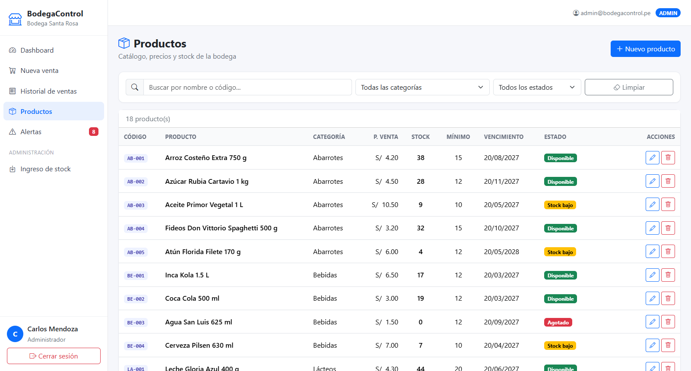

# BodegaControl – Frontend (Angular)

Interfaz web del sistema de inventario y ventas **BodegaControl** (caso: Bodega Santa Rosa).
Proyecto del curso *Soluciones Web y Aplicaciones Distribuidas* – Ingeniería de Sistemas Computacionales, UPN.

Consume la API REST en Spring Boot: https://github.com/milladetel/bodegacontrol-backend



## Tecnologías

- Angular 19 (componentes standalone, signals, formularios reactivos, router con guards)
- Bootstrap 5.3 y Bootstrap Icons
- HttpClient con interceptor JWT

## Ejecución

Requisitos: Node.js 20 y el backend corriendo en `http://localhost:8080`.

```bash
npm install
ng serve
```

Abrir `http://localhost:4200` e ingresar con:

| Usuario | Contraseña | Rol |
|---------|-----------|-----|
| admin   | admin123  | Administrador |
| cajero  | cajero123 | Cajero |

La URL de la API se configura en `src/environments/environment.ts`.

## Pantallas

| Ruta | Componente | Acceso |
|------|-----------|--------|
| `/login` | LoginComponent | Público |
| `/dashboard` | DashboardComponent | Administrador y cajero |
| `/productos` | ProductoListaComponent | Administrador y cajero (consulta) |
| `/productos/nuevo`, `/productos/:id/editar` | ProductoFormComponent | Administrador |
| `/ventas/nueva` | VentaNuevaComponent | Administrador y cajero |
| `/ventas` | VentaListaComponent | Administrador y cajero |
| `/ingresos` | IngresoStockComponent | Administrador |
| `/alertas` | AlertaStockComponent | Administrador y cajero |

## Estructura

```
src/app
├── core       modelos, AuthService, servicios HTTP, interceptor, guards, toasts
├── layout     menú lateral y barra superior
├── pages      una carpeta por pantalla
└── shared     componentes reutilizables (EstadoBadge)
```

## Capturas

| Nueva venta | Productos |
|---|---|
|  |  |

## Autores

- De la Cruz Huaranca, Luis Cristian
- Milla Guerrero, Epifanio Eulogio
- Ruiz Robles, Elianni Jhoselin
- Lizana Romero, Nilton
